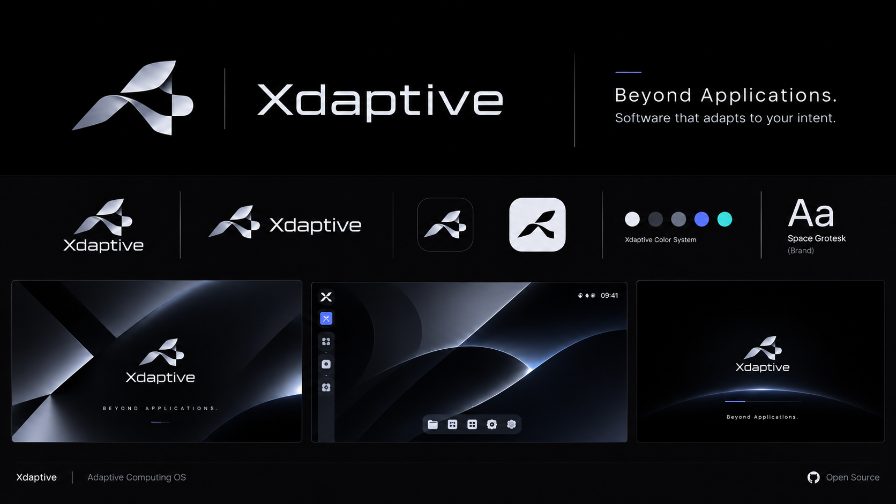

<div align="center">



# Xdaptive

**Beyond Applications.**

*Software that adapts to your intent.*

**Adaptation is a system capability.**

[](LICENSE)
[](docs/01-vision.md)
[](docs/12-roadmap.md)
[](Cargo.toml)

[English](README.md) · [한국어](README.ko.md)

</div>

---

## Xdaptive란

Xdaptive는 사용자의 **작업을 중심으로 소프트웨어를 생성·컴파일·실행·진화**시키는
**Adaptive Computing OS**다.

오늘날의 컴퓨터는 프로그램이 중심이다. 사용자가 프로그램을 고르고, 그 인터페이스를
익히고, 프로그램이 가진 기능에 맞춰 자신의 작업을 구부린다. Xdaptive는 이 관계를
뒤집는다. 중심은 **작업**이다. 운영체제가 의도를 해석하고, 작업에 필요한 소프트웨어를
구성해 하나의 통합된 **Workspace**로 실행하며, 작업이 바뀌면 그 자리에서 적응시킨다.

그 결과 소프트웨어의 단위 자체가 달라진다. 설치하는 고정된 완제품이 아니라, 시스템이
구성하고 검증하고 변화시키는 실행 환경이다.

> 사람의 의도를 중심으로 소프트웨어를 생성·컴파일·실행·진화시키는 운영체제.
>
> 소프트웨어는 더 이상 고정되어 있지 않다. 작업에 적응한다.

## Xdaptive가 아닌 것

중요한 주장일수록 오해하기 쉽기에, 경계를 먼저 밝힌다.

- **"AI 기능을 얹은 운영체제"가 아니다.** AI는 의도를 해석하고 변경을 제안하는 한
  가지 수단이다. Xdaptive의 본질은 소프트웨어를 표현·검증·실행·진화시키는 시스템,
  즉 IR·컴파일러·런타임·구성 엔진에 있다.
- **AI가 컴퓨터를 조작하는 것이 아니다.** 모델은 OS의 권한을 갖지 않는다. 계획을
  제안하면, OS가 검증하고 샌드박스에서 실행하며, 실패하면 롤백한다.
- **모든 프로그램을 재작성할 수 있다는 주장이 아니다.** 적응에는 세 단계(인터페이스·
  워크플로·프로그램)가 있고 소프트웨어마다 가능한 범위가 다르다. OS는 그 범위를
  파악하고 그 안에서만 움직여야 한다.
- **리버스 엔지니어링이 모든 것을 오픈소스로 만든다는 약속이 아니다.** 바이너리를
  분석할 수 있다는 사실이 그 코드를 복제·재배포할 권리를 뜻하지는 않는다.

## 패러다임의 전환

| | 기존 OS | Xdaptive OS |
|---|---|---|
| 중심 | 프로그램 | 작업 |
| 소프트웨어 | 고정된 완제품 | 필요에 따라 구성되는 실행 환경 |
| 사용자 경험 | 프로그램 중심 | 작업 중심 |
| 기능 확장 | 설치·플러그인·설정 | 기능 단위의 동적 구성 |
| 연결 | 사용자가 직접 연결 | OS가 작업에 맞게 구성 |
| 인터페이스 | 프로그램별로 고정 | 작업에 따라 합성 |
| 상태 | 프로그램별 저장 | Workspace 중심 관리 |
| 변경 | 프로그램 내부 설정·수동 조작 | 구조적 변경, 증분 적용 |

## 아키텍처 한눈에 보기

여섯 계층. 아래 두 계층은 Linux를 활용하고, 위 네 계층에 프로젝트의 독자 기술이 있다.

| 계층 | 책임 |
|---|---|
| **L6 · Unified Experience** | Adaptive Desktop, Workspace Shell, 동적 UI, 상호작용 |
| **L5 · Workspace Runtime** | Workspace 생명주기, 상태, 버전, 체크포인트, 복구 |
| **L4 · Adaptive Composition Engine** | Software Registry·분석, Capability 해석, AIR, 컴파일러, 구성, 트랜잭션 적응 |
| **L3 · Intelligence Runtime** | 의도 이해, 작업 계획, 모델 라우팅, 구조화 출력·검증 |
| **L2 · System & Security Runtime** | 프로세스·서비스, IPC, 자원, 격리, Capability 보안 |
| **L1 · Hardware & Kernel** | Linux 커널, 드라이버, 시스템 호출 (자체 커널은 장기 연구) |

자세한 내용은 [`docs/02-architecture.md`](docs/02-architecture.md).

## 네 가지 핵심 기술

Xdaptive는 기존 도구를 감싼 것이 아니다. 다음 네 가지를 직접 설계하고 구현한다.

1. **Adaptive IR (AIR)** — 소프트웨어 구성과 변경을 표현하는 구조화된 중간 표현.
   모델의 출력은 AIR로 변환·검증된 뒤에만 실행된다. 계획을 곧바로 실행하지 않는다.
2. **Adaptive Compiler** — AIR을 실행 가능한 구조로 변환한다. 파싱, 타입 검사, 의존성·
   데이터 흐름 분석, 최적화, 증분 컴파일. 무엇이 실행되는지에 대한 책임은 모델이
   아니라 컴파일러에 있다.
3. **Adaptive Execution Architecture** — 프로그램을 런타임에 추가·교체·제거할 수 있는
   모듈의 집합으로 취급하며, 작업 상태를 보존한다.
4. **Persistent Workspace Engine** — Workspace의 생명주기·버전·체크포인트·복구·복제를
   소유하는 런타임.

그와 함께 **Software Capability Model**, **Capability Resolver**, **Adaptive
Composition Engine**, **Transactional Adaptation**, **UI Synthesizer**,
**Intelligent Resource Runtime**을 설계한다.

## 변경은 어떻게 일어나는가

Workspace는 고유한 생명주기를 가진 객체다:
`Create → Initialize → Execute → Extend → Adapt → Persist → Restore → Clone →
Terminate`. 변경은 트랜잭션으로 적용되므로, 실패해도 Workspace가 깨지지 않는다.

```text
Snapshot → Plan → Validate → Stage → Test → Commit   (실패 시 → Rollback)
```

사용자가 새 기능을 요청하면, OS는 그것을 만족하는 최소 변경을 계산하고, 실행 중인
환경 옆에서 만들어 테스트한 뒤, 통과할 때만 반영한다 — 데이터와 상태를 보존하면서.

## 현재 상태

**Stage 0 — System Specification.** 현재 저장소에는 [`docs/`](docs/README.md)의 명세
세트와 Rust Cargo 워크스페이스 골격이 있다. 첫 Proof of Concept(CSV 분석 Workspace에
상관관계·산점도 Capability를 상태 손실 없이 추가)는
[`docs/13-poc.md`](docs/13-poc.md)에 있다. 아직 실제로 쓸 수 있는 소프트웨어가
아니며, 로드맵은 진행 상황을 과장하지 않는다.

## 저장소 구조

```text
Xdaptive/
├── docs/                 명세 (계약)
│   ├── vision.ko.md      한국어 마스터 비전
│   └── rfc/              번호가 붙은 설계 기록
├── core/                 기반 런타임 크레이트
├── adaptation/           AIR, 레지스트리, 리졸버, 구성, 컴파일러
├── execution/            워크플로 엔진, 프로세스 매니저, IPC, 샌드박스
├── security/             정책 엔진, Capability 시스템
├── intelligence/         모델 런타임, 의도 컴파일러, 모델 라우터
├── desktop/              Workspace Shell, UI 런타임
├── integrations/         소프트웨어 어댑터, Capability 팩
└── tools/                `aos` CLI와 개발 도구
```

이는 목표 구조다. 인터페이스가 안정된 크레이트부터 분리하므로, 초기에는 한 디렉터리에
크레이트가 하나만 있을 수 있다.

## 문서

| 문서 | 내용 |
|---|---|
| [00-glossary.md](docs/00-glossary.md) | 나머지 문서가 의존하는 용어 |
| [01-vision.md](docs/01-vision.md) | 정체성, 논지, 차별성 |
| [02-architecture.md](docs/02-architecture.md) | 여섯 계층과 데이터 모델 |
| [03-workspace.md](docs/03-workspace.md) | Workspace 모델·생명주기·저장 |
| [04-capability-model.md](docs/04-capability-model.md) | Capability와 Software Manifest |
| [05-adaptive-ir.md](docs/05-adaptive-ir.md) | AIR |
| [06-adaptive-compiler.md](docs/06-adaptive-compiler.md) | 컴파일러 파이프라인 |
| [07-execution-model.md](docs/07-execution-model.md) | 적응 단계와 실행 |
| [08-software-understanding.md](docs/08-software-understanding.md) | 분석과 재구성 |
| [09-security-model.md](docs/09-security-model.md) | AI/OS 분리, 권한, 격리 |
| [10-adaptation-transactions.md](docs/10-adaptation-transactions.md) | 안전하고 원자적인 변경 |
| [11-performance.md](docs/11-performance.md) | 네이티브 경로, 증분 작업 |
| [12-roadmap.md](docs/12-roadmap.md) | Stage 0–6 |
| [13-poc.md](docs/13-poc.md) | 첫 Proof of Concept |
| [14-evaluation.md](docs/14-evaluation.md) | 무엇을 측정하는가 |
| [15-principles.md](docs/15-principles.md) | 열 가지 설계 원칙 |
| [16-open-questions.md](docs/16-open-questions.md) | 아직 열려 있는 결정 |

## 기여

기여를 환영한다. 절차는 의도적으로 지루하다: **명세가 먼저, 그리고 하나의 논리적
변경이 하나의 커밋.** [CONTRIBUTING.md](CONTRIBUTING.md)와
[Code of Conduct](CODE_OF_CONDUCT.md)를 읽어 달라.

## 지원과 보안

질문과 열린 아이디어는
[GitHub Discussions](https://github.com/x1zzdev/Xdaptive/discussions)로, 구체적인
버그와 제안은 [Issues](https://github.com/x1zzdev/Xdaptive/issues)로. 보안 취약점은
[SECURITY.md](SECURITY.md)에 따라 비공개로 보고하고, 공개 이슈에 쓰지 않는다.

## 라이선스

Apache License 2.0 — [LICENSE](LICENSE)와 [NOTICE](NOTICE) 참고. 이름과 슬로건은
[상표 정책](TRADEMARK.md)의 적용을 받는다. Xdaptive가 생성한 코드는 이 라이선스를
자동으로 승계하지 않는다 — [생성 코드 정책](GENERATED-CODE-POLICY.md) 참고.
