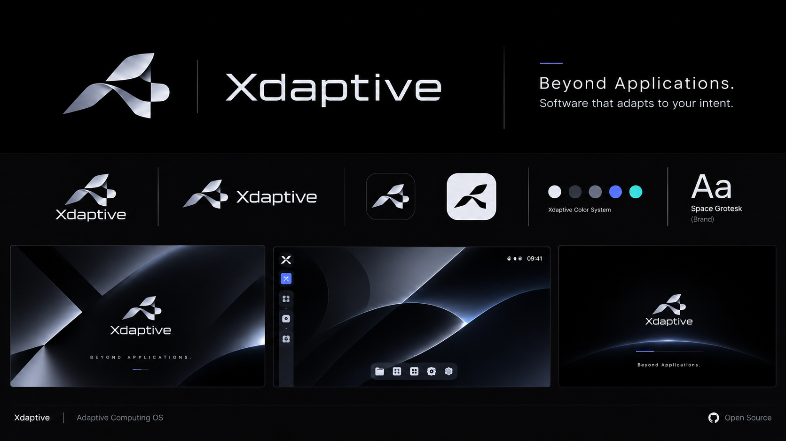

<div align="center">



# Xdaptive

**Beyond Applications.**

*Software that adapts to your intent.*

**Adaptation is a system capability.**

[](LICENSE)
[](docs/01-vision.md)
[](docs/12-roadmap.md)
[](Cargo.toml)
[](docs/README.md)

[English](README.md) · [한국어](README.ko.md)

</div>

---

## What Xdaptive is

Xdaptive is an **Adaptive Computing OS**: an operating system that generates,
compiles, executes and evolves software around what the user is trying to do.

In today's computers the program is the centre. You pick the program, learn its
interface, and bend your work to fit the features it happens to ship. Xdaptive
reverses that relationship. The **task** is the centre. The OS interprets the
intent, assembles the software the task needs, and keeps it running as a single
integrated **Workspace** — adapting it in place when the task changes.

The consequence is a different unit of software. Not a fixed product you
install, but an execution environment that is composed, verified and mutated by
the system.

> An operating system that generates, compiles, executes and evolves software
> around human intent.
>
> Software is no longer fixed. It adapts to the task.

## What Xdaptive is not

The interesting claims are the ones that are easy to get wrong, so the project
states its boundaries up front.

- **It is not "an OS with an AI feature bolted on."** AI is one way to interpret
  intent and propose a change. The substance of Xdaptive is the system that
  represents, verifies, executes and evolves software — the IR, the compiler,
  the runtime and the composition engine.
- **It is not an AI that drives your computer.** A model never holds OS
  authority. It proposes a plan; the OS validates it, sandboxes it, and rolls it
  back if it fails.
- **It is not a claim that any program can be rewritten.** Adaptation has three
  levels (interface, workflow, program) and every piece of software supports a
  different range. The OS must know the range and stay inside it.
- **It is not a promise that reverse engineering makes everything open.** Being
  able to analyse a binary is not a right to copy or redistribute its code.

## The shift

| | Conventional OS | Xdaptive OS |
|---|---|---|
| Centre | the program | the task |
| Software | a fixed product | an execution environment, composed on demand |
| User experience | program-centric | task-centric |
| Extension | install, plug-ins, settings | dynamic composition of capability units |
| Wiring | the user connects programs | the OS wires them for the task |
| Interface | fixed per program | synthesised per task |
| State | saved per program | managed per Workspace |
| Change | in-app settings, manual edits | structural change, applied incrementally |

## Architecture at a glance

Six layers, top to bottom. The lower two are borrowed from Linux; the upper
four are where the project's own technology lives.

| Layer | Responsibility |
|---|---|
| **L6 · Unified Experience** | Adaptive desktop, Workspace shell, dynamic UI, interaction |
| **L5 · Workspace Runtime** | Workspace lifecycle, state, versions, checkpoints, recovery |
| **L4 · Adaptive Composition Engine** | Software registry and analysis, capability resolution, AIR, compiler, composition, transactional adaptation |
| **L3 · Intelligence Runtime** | Intent understanding, task planning, model routing, structured output + validation |
| **L2 · System & Security Runtime** | Processes, services, IPC, resources, isolation, capability security |
| **L1 · Hardware & Kernel** | Linux kernel, drivers, syscalls (a self-hosted kernel is long-term research, not a Stage 0 goal) |

The full description is in [`docs/02-architecture.md`](docs/02-architecture.md).

## The four core technologies

Xdaptive is not a wrapper around existing tools. Four pieces are designed and
built here:

1. **Adaptive IR (AIR)** — a structured intermediate representation of software
   composition and change. A model's output is translated into AIR and verified
   before anything executes; a plan is never run directly.
2. **Adaptive Compiler** — turns AIR into an executable structure: parsing, type
   checking, dependency and dataflow analysis, optimisation, and incremental
   compilation. It, not the model, is accountable for what runs.
3. **Adaptive Execution Architecture** — treats a program as a composable set of
   modules that can be added, replaced or removed at runtime while preserving
   task state.
4. **Persistent Workspace Engine** — the runtime that owns a Workspace's
   lifecycle, versioning, checkpointing, recovery and cloning.

Alongside them: a **Software Capability Model**, a **Capability Resolver**, an
**Adaptive Composition Engine**, **Transactional Adaptation**, a **UI
Synthesizer**, and an **Intelligent Resource Runtime**.

## How a change happens

A Workspace is a long-lived object with its own lifecycle:
`Create → Initialize → Execute → Extend → Adapt → Persist → Restore → Clone →
Terminate`. A change is applied transactionally, so a failure never leaves the
Workspace broken:

```text
Snapshot → Plan → Validate → Stage → Test → Commit   (or → Rollback)
```

A user asks for something new; the OS computes the smallest change that
satisfies it, builds and tests it beside the running environment, and commits
it only if it passes — keeping the user's data and state intact.

## Status

**Stage 0 — System Specification.** The repository currently holds the
specification set in [`docs/`](docs/README.md) and the Rust Cargo workspace
skeleton. The first proof of concept (a CSV analysis Workspace that gains a
correlation/scatter-plot capability without losing state) is described in
[`docs/13-poc.md`](docs/13-poc.md). Nothing here claims to be usable software
yet, and the roadmap does not overstate progress.

## Repository layout

```text
Xdaptive/
├── docs/                 the specification (the contract)
│   ├── vision.ko.md      the original Korean master vision
│   └── rfc/              numbered design records
├── core/                 foundational runtime crates
├── adaptation/           AIR, registry, resolver, composition, compiler
├── execution/            workflow engine, process manager, IPC, sandbox
├── security/             policy engine, capability system
├── intelligence/         model runtime, intent compiler, model router
├── desktop/              workspace shell, UI runtime
├── integrations/         software adapters, capability packs
└── tools/                the `aos` CLI and developer tools
```

This is the target layout. Crates are split out only once their interface is
stable, so early directories may hold a single crate.

## Documentation

| Document | Contents |
|---|---|
| [00-glossary.md](docs/00-glossary.md) | The vocabulary the rest of the docs depend on |
| [01-vision.md](docs/01-vision.md) | Identity, thesis and differentiation |
| [02-architecture.md](docs/02-architecture.md) | The six layers and the data model |
| [03-workspace.md](docs/03-workspace.md) | Workspace model, lifecycle and persistence |
| [04-capability-model.md](docs/04-capability-model.md) | Capability and Software Manifest |
| [05-adaptive-ir.md](docs/05-adaptive-ir.md) | AIR |
| [06-adaptive-compiler.md](docs/06-adaptive-compiler.md) | Compiler pipeline |
| [07-execution-model.md](docs/07-execution-model.md) | Adaptation levels and execution |
| [08-software-understanding.md](docs/08-software-understanding.md) | Analysis and reconstruction |
| [09-security-model.md](docs/09-security-model.md) | AI/OS split, permissions, isolation |
| [10-adaptation-transactions.md](docs/10-adaptation-transactions.md) | Safe, atomic change |
| [11-performance.md](docs/11-performance.md) | Native paths, incremental work |
| [12-roadmap.md](docs/12-roadmap.md) | Stages 0–6 |
| [13-poc.md](docs/13-poc.md) | The first proof of concept |
| [14-evaluation.md](docs/14-evaluation.md) | What gets measured |
| [15-principles.md](docs/15-principles.md) | The ten design principles |
| [16-open-questions.md](docs/16-open-questions.md) | The decisions still open |

## Contributing

Contributions are welcome. The process is deliberately boring: **the
specification comes first, and one logical change is one commit.** Read
[CONTRIBUTING.md](CONTRIBUTING.md) and the [Code of Conduct](CODE_OF_CONDUCT.md).
Everyone participating agrees to the Code of Conduct.

## Support and security

Questions and open-ended ideas go to
[GitHub Discussions](https://github.com/x1zzdev/Xdaptive/discussions); concrete
bugs and proposals go to [Issues](https://github.com/x1zzdev/Xdaptive/issues).
Report vulnerabilities privately as described in [SECURITY.md](SECURITY.md),
never in a public issue.

## License

Apache License 2.0 — see [LICENSE](LICENSE) and [NOTICE](NOTICE). The names and
slogan are covered by the [trademark policy](TRADEMARK.md). Code generated by
Xdaptive is **not** automatically under this license; see the
[generated-code policy](GENERATED-CODE-POLICY.md).
